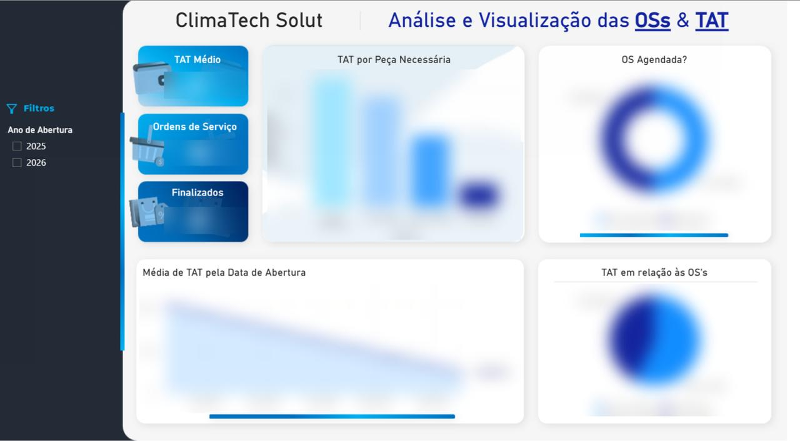
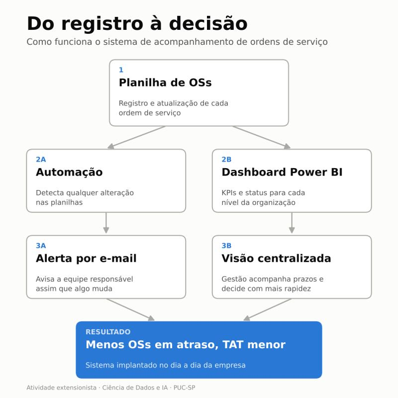

# Dashboard de BI para monitoramento de ordens de serviço

Atividade extensionista da PUC-SP com uma **empresa real do setor de climatização** (jan–jun 2026). A empresa precisava acompanhar suas ordens de serviço (OSs) e ser avisada quando as planilhas mudavam.

> O sistema foi implementado e é usado no dia a dia da operação da empresa.



*Valores borrados para preservar os dados da empresa.*

## O que foi entregue

- **Dashboard interativo em Power BI** com KPIs (TAT médio, total de OSs, finalizados) e sinalização de status para diferentes níveis da organização.
- **Automação das planilhas**, que detecta qualquer alteração.
- **Alertas por e-mail** para a equipe responsável assim que algo muda.

## Como funciona



1. **Planilha de OSs:** registro e atualização de cada ordem de serviço.
2. **Automação → alerta por e-mail:** avisa a equipe quando algo muda.
3. **Dashboard → visão centralizada:** a gestão acompanha prazos e decide mais rápido.

**Resultado:** menos OSs em atraso e TAT (turnaround time) menor.

## Estrutura

```
docs/      documentação e materiais do projeto
imagens/   imagens do README
```

## Ferramentas

Microsoft Power BI · Relatórios de KPI · Automação de planilhas

## Equipe

João Pedro Coelho, Théo Henrique, Maria Gabriela e equipe · Ciência de Dados e IA · PUC-SP
